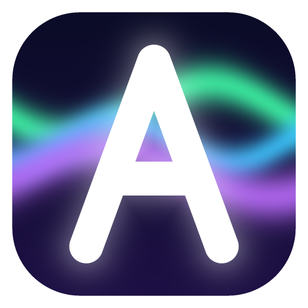

<p align="center">
  
</p>

<h1 align="center">Aurora Launcher</h1>

<p align="center">
  Красивый лаунчер Minecraft: Java Edition — сборки, моды, модпаки, Java-менеджер, редактор скинов и ИИ-разбор крашей.<br/>
  <a href="https://github.com/KIRILLTAN/aurora-launcher/releases/latest"><b>⬇ Скачать последнюю версию</b></a>
</p>

---

## Возможности

| | |
|---|---|
| 🎮 **Любые версии** | Все релизы, снапшоты, beta и alpha из официального манифеста Mojang |
| 🧩 **Загрузчики модов** | Fabric, Quilt, Forge и NeoForge — устанавливаются автоматически, без окон установщика |
| 📦 **Модпаки** | Поиск и установка с [Modrinth](https://modrinth.com/modpacks) и [CurseForge](https://www.curseforge.com/minecraft/modpacks), импорт `.mrpack` и `.zip`, экспорт своих сборок в `.mrpack` |
| 🔧 **Управление модами** | Включение/отключение, удаление, поиск и установка модов, ресурспаков и шейдеров с автоматической установкой зависимостей |
| 👤 **Аккаунты** | Microsoft (лицензия), [Ely.by](https://ely.by), аккаунты лаунчера через [authlib-injector](https://github.com/yushijinhun/authlib-injector) (LittleSkin или свой сервер) и оффлайн |
| ☕ **Встроенный Java-менеджер** | Автопоиск установленных Java, ручное добавление, загрузка любой версии [Eclipse Temurin](https://adoptium.net) с подсказками, для каких версий Minecraft она подходит. В режиме «Авто» нужная Java скачивается сама |
| 🤖 **ИИ-анализ крашей** | Когда игра падает, лаунчер объясняет **почему**: какие моды конфликтуют, каких зависимостей не хватает, нужна ли другая Java или больше памяти. Встроенный анализатор работает офлайн; для подробного разбора можно подключить Claude |
| 🎨 **Редактор скинов** | Попиксельный редактор 64×64 с заливкой, пипеткой, осветлением/затемнением, симметрией рук и ног, слоями и живым 3D-превью. Загрузка скина по нику (Mojang/Ely.by) и установка на аккаунт Microsoft в один клик |
| 🌐 **Онлайн с GitHub** | Новости и рекомендованные сборки читаются из этого репозитория, обновления лаунчера скачиваются из GitHub Releases автоматически |
| ☁️ **Облако Aurora** | Синхронизация сборок между компьютерами 1 в 1: версия, загрузчик, моды, ресурспаки, шейдеры, настройки и конфиги. Хранилище — приватный GitHub Gist или облачная папка (Яндекс Диск, OneDrive, Google Drive) |
| ⌨️ **Помощник в игре (F6)** | Оверлей (не мод) для любой версии и загрузчика, даже ванилли: лут списком, иконки над лутом сквозь блоки, HUD брони и щита, координаты, FPS, часы |
| 🌐 **Зеркала и свой VPN** | Если Modrinth, CurseForge или Mojang плохо открываются — загрузка идёт через зеркала MCIM и BMCLAPI; можно указать свой VPN/прокси (SOCKS5/HTTP) |
| 👕 **Скины на оффлайн-аккаунтах** | Скин из редактора ставится на оффлайн-аккаунт и виден в игре |
| ✨ **Шейдеры в один клик** | При установке шейдерпака лаунчер сам ставит Iris + Sodium или Oculus + Embeddium |
| 🌍 **Мои серверы** | Онлайн, пинг, MOTD и иконка сервера; кнопка «Играть» запускает сборку и сразу заходит на сервер |
| ⚡ **Ускорить FPS** | Один клик ставит Sodium/Embeddium, Lithium, FerriteCore, EntityCulling, ImmediatelyFast, ModernFix |
| ⬆️ **Обновления модов** | Проверка и обновление всех модов сборки до последних версий под ваш Minecraft |
| 🗺️ **Миры и скриншоты** | Список миров с бэкапом в zip одним кликом, галерея скриншотов |
| 📥 **Импорт чужих сборок** | Архив или папка из Prism Launcher, MultiMC, CurseForge App, ATLauncher, TLauncher или просто `.minecraft` — переносятся моды, конфиги, миры, карты, ресурспаки и настройки; версия и загрузчик определяются автоматически |
| ⏹️ **Отмена установки** | Любую установку сборки, загрузчика, Java или загрузку из облака можно отменить кнопкой «Отменить» — недокачанная сборка удаляется |
| 🚀 **Оптимизация игры** | Профили JVM (оптимизированный G1 или ZGC для Java 21+), автоподбор памяти по числу модов, высокий приоритет процесса игры |
| ✨ **Интерфейс** | Тёмная тема с анимированным северным сиянием, стеклянные панели, 5 цветовых акцентов, живая консоль игры |

## Установка (для игроков)

1. Откройте страницу **[Releases](https://github.com/KIRILLTAN/aurora-launcher/releases/latest)**.
2. Скачайте один из файлов:
   - `Aurora-Launcher-Setup-x.x.x.exe` — установщик для Windows (рекомендуется, с автообновлением);
   - `Aurora-Launcher-x.x.x-portable.exe` — портативная версия без установки;
   - `Aurora-Launcher-x.x.x-linux-x86_64.AppImage` — для Linux.
3. Запустите. Windows может показать окно SmartScreen («Windows защитила ваш компьютер»), потому что у лаунчера нет платной цифровой подписи — нажмите **«Подробнее» → «Выполнить в любом случае»**.

## Как пользоваться

### 1. Добавьте аккаунт
Вкладка **«Аккаунты» → «Добавить аккаунт»**:
- **Microsoft** — откроется официальное окно входа Microsoft. Нужен купленный Minecraft: Java Edition.
- **Ely.by** — бесплатный аккаунт со скинами ([регистрация](https://account.ely.by/register)). Если включена 2FA, введите пароль как `пароль:код`.
- **Аккаунт лаунчера** — любой сервер авторизации authlib-injector, например [LittleSkin](https://littleskin.cn) или ваш собственный (Blessing Skin и т.п.).
- **Оффлайн** — только ник, для одиночной игры и серверов без лицензии.

### Импорт сборки из другого лаунчера
«Мои сборки» → **«Импорт архива»** или **«Импорт папки»** (или просто перетащите архив/папку в окно). Поддерживаются экспорт Prism Launcher / MultiMC (`instance.cfg` + `mmc-pack.json`), CurseForge App, ATLauncher, TLauncher и любая папка `.minecraft`, а также `.mrpack` и модпаки CurseForge. Лаунчер покажет найденную версию, загрузчик, число модов и миров — их можно поправить перед импортом.

### 2. Создайте сборку
Кнопка **«Создать сборку»**:
- **Выбрать версию** — версия Minecraft + загрузчик (Vanilla/Fabric/Quilt/Forge/NeoForge) и его версия.
- **Готовые модпаки** — поиск по Modrinth и CurseForge, установка в один клик.
- **Из файла** — перетащите `.mrpack` или `.zip` (CurseForge).

Файлы игры скачиваются при первом запуске. Java подбирается автоматически.

### 3. Моды, ресурспаки, шейдеры
Откройте сборку → вкладки **«Моды»**, **«Ресурспаки»**, **«Шейдеры»** → **«Добавить»**. Лаунчер сам найдёт версию под ваш Minecraft и загрузчик и доустановит обязательные зависимости (например, Fabric API).

### 4. Если игра вылетела
Появится окно с разбором: причина, подозреваемые моды и шаги для исправления. Кнопка **«Спросить ИИ»** отправит лог в Claude для подробного объяснения (нужен свой ключ, см. ниже).

### Синхронизация сборок между ПК (Облако Aurora)
Вкладка **«Аккаунты» → «Облако Aurora»**, выберите способ:
- **Войти по токену GitHub** — нажмите «Создать токен на GitHub» (откроется [страница](https://github.com/settings/tokens/new?scopes=gist&description=Aurora%20Launcher%20Sync) с уже отмеченным правом `gist`), создайте токен и вставьте его. Сборки хранятся в приватном Gist вашего аккаунта GitHub.
- **Облачная папка** — выберите папку Яндекс Диска, OneDrive или Google Drive на компьютере. Туда же копируются моды, которых нет на Modrinth/CurseForge.

На первом ПК нажмите **«Отправить все»** (дальше сборка отправляется сама после каждой игры). На втором ПК войдите в то же облако — сборки появятся в «Моих сборках» в разделе **«В облаке»**, нажмите **«Скачать»**. Моды скачиваются с Modrinth/CurseForge по контрольным суммам, конфиги и настройки переносятся как есть.

### Помощник в игре (F6)
**«Настройки» → «Кастомный помощник в игре»** → включите галочку. Это **не мод**: лаунчер подключает к игре маленький Java-агент и рисует прозрачный оверлей поверх окна Minecraft. Работает на **ванилле и любом загрузчике** — Fabric, Quilt, NeoForge, Forge 1.17+, Minecraft 1.14.4 и новее, включая 26.x.

В игре нажмите **F6** — откроется меню (↑↓ — выбор, ←→ или Enter — изменить, F6/Esc — закрыть):
- **лут списком** — предметы на земле с количеством, расстоянием и стрелкой-направлением;
- **иконки над лутом** — над каждым лежащим предметом видна его иконка, даже сквозь блоки;
- **HUD брони** справа от хотбара и **HUD щита** слева (без щита — предмет в левой руке), с прочностью;
- координаты, FPS, игровые часы, радиус 8–64 блока.

Игру лучше запускать в оконном режиме или «без рамки» — поверх эксклюзивного полноэкранного режима оверлей может не отображаться.

### Если Modrinth/CurseForge не открываются (Россия и др.)
**«Настройки» → «Сеть: зеркала и VPN»**:
- **Зеркала** — «Авто» (по умолчанию) переключается на зеркала MCIM (Modrinth, CurseForge) и BMCLAPI (Mojang, Forge, NeoForge, Fabric) при ошибке; можно выбрать «Всегда через зеркала».
- **Свой VPN/прокси** — укажите локальный адрес из VPN-клиента (v2rayN, Hiddify, Clash, Outline и т.п. обычно дают SOCKS5 `127.0.0.1:10808` или HTTP-порт). Без этого используется системный прокси.
- **Проверить соединение** — покажет, какие сервисы доступны.

### Скин на оффлайн-аккаунт
Вкладка **«Скины»** → нарисуйте или загрузите скин → **«Установить на аккаунт»** при активном оффлайн-аккаунте. Лаунчер поднимает на компьютере маленький скин-сервер, и игра берёт скин у него через authlib-injector. Скин виден вам в игре (в одиночной игре и от третьего лица); другим игрокам на сервере — только если сервер поддерживает скины (например, SkinsRestorer).

### Шейдеры
Вкладка сборки **«Шейдеры»** → установите шейдерпак — лаунчер сам поставит **Iris + Sodium** (Fabric, Quilt, NeoForge 1.21+) или **Oculus + Embeddium** (Forge 1.20.1). Для ванильной сборки шейдеры недоступны — создайте сборку Fabric.

### 5. Java
Вкладка **«Java»**:
- **Автопоиск** — находит все Java на компьютере (Program Files, JAVA_HOME, PATH, официальный лаунчер, Prism);
- **Указать java.exe / папку** — добавить вручную;
- **Скачать Java** — любая версия Temurin (8, 11, 17, 21, 25…) с подсказкой, для каких версий Minecraft она нужна.

| Minecraft | Нужна Java |
|---|---|
| 1.0 – 1.16.5 | 8 |
| 1.17.x | 16+ |
| 1.18 – 1.20.4 | 17 |
| 1.20.5 – 1.21.x | 21 |
| 26.1 и новее | 25 |

## Ключи API (необязательно)

| Сервис | Зачем | Где взять |
|---|---|---|
| **CurseForge** | Необязательно: без ключа CurseForge работает через зеркало MCIM. Свой ключ — прямой доступ | [console.curseforge.com](https://console.curseforge.com/) → API Keys (бесплатно) |
| **Claude (Anthropic)** | Подробный ИИ-разбор крашей | [platform.claude.com](https://platform.claude.com/settings/keys) |

Вставьте ключи в **«Настройки»**. Они хранятся только у вас на компьютере. Лог краша уходит в Claude API, только когда вы сами нажимаете «Спросить ИИ».

## Онлайн-контент из GitHub

Лаунчер при запуске читает два файла из этого репозитория (ветка `main`):

- [`remote/news.json`](remote/news.json) — новости на главной странице и приветствие (`motd`);
- [`remote/featured.json`](remote/featured.json) — блок «Сборки от KIRILLTAN».

Чтобы изменить новости или список сборок, отредактируйте эти файлы прямо на GitHub (значок карандаша) — лаунчер подхватит изменения при следующем открытии.

Формат сборки в `featured.json`:
```json
{ "title": "Моя сборка", "description": "Описание", "image": "https://…/cover.png", "ref": "modrinth:slug-или-id", "tag": "новое" }
```
`ref` может быть:
- `modrinth:<slug или id>` — модпак с Modrinth;
- `curseforge:<id проекта>` — модпак с CurseForge;
- `url:https://github.com/KIRILLTAN/aurora-launcher/releases/download/packs/my-pack.mrpack` — **ваша собственная сборка**, загруженная в релиз GitHub.

### Как выложить свою сборку
1. В лаунчере откройте сборку → кнопка **«Экспорт»** → сохраните `.mrpack`.
2. На GitHub: **Releases → Draft a new release**, тег например `packs`, прикрепите `.mrpack`, опубликуйте.
3. Скопируйте ссылку на файл и добавьте в `remote/featured.json` с `"ref": "url:<ссылка>"`.

## Для разработчиков

Нужен [Node.js 22+](https://nodejs.org).

```bash
git clone https://github.com/KIRILLTAN/aurora-launcher.git
cd aurora-launcher
npm install
npm run dev      # запуск в режиме разработки
npm run build    # проверка типов и сборка
npm run dist     # установщик в папке dist/
```

### Выпуск новой версии
1. Поменяйте `version` в `package.json` (например, `1.0.1`).
2. Закоммитьте и создайте тег:
   ```bash
   git tag v1.0.1
   git push origin main --tags
   ```
3. GitHub Actions ([release.yml](.github/workflows/release.yml)) соберёт установщики для Windows и Linux и опубликует релиз. Установленные лаунчеры обновятся сами.

### Устройство
```
src/main/          — процесс Electron: установка, запуск, аккаунты, Java, моды
  minecraft/       — версии Mojang, библиотеки, ассеты, загрузчики, запуск
  auth/            — Microsoft (Xbox Live), Ely.by и authlib-injector, оффлайн
  java/            — поиск и установка Java (Adoptium API)
  catalog/         — Modrinth, CurseForge, модпаки
  crash/           — анализатор крашей и ИИ (Claude API)
  sync.ts          — облачная синхронизация сборок (GitHub Gist / облачная папка)
  features.ts      — пинг серверов, ускорение FPS, обновления модов, миры, скриншоты
src/renderer/      — интерфейс на React
helper-mod/        — мод Aurora Helper (Fabric, Java): меню F6, лут на земле
remote/            — онлайн-контент, который лаунчер читает с GitHub
```

Используемые API: [Mojang piston-meta](https://piston-meta.mojang.com/mc/game/version_manifest_v2.json), [Fabric Meta](https://meta.fabricmc.net), [Quilt Meta](https://meta.quiltmc.org), [Forge Maven](https://maven.minecraftforge.net), [NeoForged Maven](https://maven.neoforged.net), [Modrinth API](https://docs.modrinth.com), [CurseForge API](https://docs.curseforge.com), [Adoptium API](https://api.adoptium.net), [Ely.by](https://docs.ely.by), [authlib-injector](https://github.com/yushijinhun/authlib-injector).

---

Aurora Launcher не связан с Mojang и Microsoft. Minecraft — товарный знак Mojang Synergies AB. Лицензия: [MIT](LICENSE).
